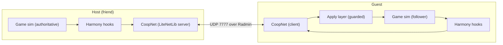

# /hexad Build Plan: Shadows of Doubt v42.04 Co-op Mod
*Handoff plan for the Gemini 3.8 High executor session. Every path and fact below was verified on David's machine on 2026-11-08 unless marked UNVERIFIED.*

---

## 0. Mission & Context

| Item | Value |
| :--- | :--- |
| Goal | Full co-op mod: 2 players, same city, visible partner, shared doors/items, shared case board, shared time, shared crime state |
| Players | David's friend (**host**: Ryzen 5 7600X, RTX 3060 Ti 8GB, 32GB DDR5, NVMe) + 1 guest (specs unknown). **David does not play.** He builds and ships the zip. |
| Network | Radmin VPN (26.x.x.x), UDP port 7777 |
| Sync style | Full Shared Investigation |
| Testing constraint | Real two-player tests happen on the friends' PCs. Local tests on David's PC use two game instances if possible (see Phase 1). |

> [!IMPORTANT]
> **Honesty rules for the executor.** The previous session overclaimed, so these are mandatory:
> 1. Never write "tested", "working" or "ready to play" unless the game was actually run and the log line is quoted.
> 2. Never invent tool verdicts. `argon-cortex.evaluate_3patterns` returns generic text. Quote it verbatim or don't cite it.
> 3. "DLSS Preset K locked" is false. `Link-GameToLab.ps1` only prints that string. Don't repeat the claim.
> 4. Every MODLOG entry fills in the "Still broken / not tested" field truthfully.

---

## 1. Verified Environment

| Item | Value |
| :--- | :--- |
| Game root | `D:\Games\Shadows.of.Doubt.v42.04\Shadows of Doubt\` |
| Engine | Unity **2021.3.45** (`UnityPlayer.dll` 2021.3.45.8976527), **IL2CPP** (`GameAssembly.dll`) |
| Anti-cheat | None |
| Loader | BepInEx **6.0.788 IL2CPP** installed (`winhttp.dll`, `doorstop_config.ini`, `dotnet\`, `BepInEx\`) |
| Interop | Generated: `BepInEx\interop\Assembly-CSharp.dll` + Unity modules |
| BepInEx boot | Confirmed. `BepInEx\LogOutput.log` exists, game reached the city ("Mods: Loading mods complete: 0") |
| Project | `D:\Modding_Lab\projects\Shadows_of_Doubt\` (`src\`, `bin\`, `analysis\`, `release\`, `MODLOG.md`) |
| Hot-deploy | NTFS junction `...\BepInEx\plugins\ShadowsOfDoubtCoop` → `D:\Modding_Lab\projects\Shadows_of_Doubt\bin` (building = deploying) |
| SDKs | .NET SDK 9.0.320 and 10.0.403. `net6.0` template not available, so the plugin targets **`netstandard2.1`** (compiles, 0 errors) |
| Packages | LiteNetLib **2.1.5** (NuGet). `NetPeer` has **no** `EndPoint` property in this version, use `peer.Id` |
| Saves snapshot | `D:\Modding_Lab\dumps\Shadows_of_Doubt\saves_snapshot_20261108_125711` |
| Current release zip | `release\Shadows_of_Doubt_Coop_v42.04_Portable.zip` (98 MB). **Connection test only, not co-op. Must not be sent as co-op.** |

### Classes confirmed to exist in `Assembly-CSharp` (members NOT yet dumped)
`Player`, `Human`, `Citizen`, `CitizenBehaviour`, `CityConstructor`, `CityData`, `SaveStateController`, `SessionData`, `ChapterController`, `FirstPersonItemController`, `Game`, `InteractionController`, `NewAddress`, `NewBuilding`, `NewDoor`, `NewRoom`, `Interactable`, `Toolbox`, `CasePanelController`, `MainMenuController`, `GameplayController`

### Recon tool (already built, use it, don't use PowerShell reflection)
PowerShell `Assembly.LoadFrom` + `AssemblyResolve` **stack-overflowed**. Use the metadata reader instead:
```powershell
$exe = "D:\Modding_Lab\projects\Shadows_of_Doubt\analysis\MetaDump\out\MetaDump.exe"
$dll = "D:\Games\Shadows.of.Doubt.v42.04\Shadows of Doubt\BepInEx\interop\Assembly-CSharp.dll"
& $exe $dll '^Player$' '.'                     # all members of Player
& $exe $dll '^NewDoor$' '(?i)open|close|lock'  # filtered members
```
Arg 1 = type-name regex, Arg 2 (optional) = member-name regex. Fields print as `F`, methods as `M`.

---

## 2. Current Source (what exists)

| File | State |
| :--- | :--- |
| `src\ShadowsOfDoubtCoop.csproj` | netstandard2.1, refs BepInEx core + interop modules (incl. TextRendering, InputLegacy) |
| `src\Plugin.cs` | `BasePlugin`, registers `CoopNetworkManager`, `harmony.PatchAll()` (no patches yet) |
| `src\CoopNetworkManager.cs` | LiteNetLib host/client, F9 IMGUI HUD, sends camera pos/rot at 30Hz, shows partner coords as text |

---

## 3. Target Architecture



**Authority model:** host owns city, time, citizens, crimes and case progress. Either player can act on doors, items and the case board. Actions go to the host, the host applies and re-broadcasts. Every apply path sets `CoopNet.IsApplyingRemote = true` so hooks don't echo packets back (re-entrancy guard).

### Target file layout (`src\`)
```
Plugin.cs                 entry, config, Harmony
Net\CoopNet.cs            LiteNetLib wrapper, connect/host, poll on main thread, send helpers
Net\Packets.cs            packet ids + read/write, protocol version
Net\FileTransfer.cs       chunked save/city transfer
Sync\PlayerSync.cs        local transform out, remote puppet in
Sync\RemotePuppet.cs      puppet GameObject + interpolation
Sync\WorldSync.cs         doors, interactables
Sync\CaseBoardSync.cs     pins, strings, evidence
Sync\TimeSync.cs          game clock + pause suppression
Sync\CrimeSync.cs         murders / case state (host -> guest)
Patches\*.cs              Harmony patches, one file per game class
UI\CoopHud.cs             F9 HUD (gold/obsidian, "Made by Syojhin" footer)
```

### Packet table (`Packets.cs`)
| Id | Name | Delivery | Direction |
| :--- | :--- | :--- | :--- |
| 0 | Hello (protocolVersion, gameVersion, modVersion) | ReliableOrdered | both, reject on mismatch |
| 1 | PlayerState (seq, pos, rot, crouch, moveSpeed) | **Sequenced** | both |
| 2 | FileChunk (fileId, index, total, bytes) | ReliableOrdered | host → guest |
| 3 | LoadReady / LoadDone | ReliableOrdered | both |
| 4 | TimeSync (gameTime, timeScale, paused) | Sequenced, 2Hz | host → guest |
| 5 | DoorState (doorId, open, locked) | ReliableOrdered | both via host |
| 6 | InteractableAction (id, actionId) | ReliableOrdered | both via host |
| 7 | CaseBoardOp (op, caseId, evidenceId, x, y, linkTo) | ReliableOrdered | both via host |
| 8 | CrimeEvent (type, victimId, ...) | ReliableOrdered | host → guest |

---

## 4. Phases (each one ends with build + MODLOG entry + honest status)

### Phase A: Fix audit bugs (Lara) ~20 min
1. Delete `reader.Recycle()` in `OnNetworkReceive` (double recycle with `AutoRecycle = true`).
2. Position packets: `DeliveryMethod.Sequenced` instead of `Unreliable`.
3. Reuse one `NetDataWriter` (call `Reset()`), no per-send allocation.
4. Wrap packet handling in try/catch + `reader.AvailableBytes` length check, log once, don't spam every frame.
5. Add Hello packet with protocol version, disconnect on mismatch.
6. Remove explicit `ClassInjector.RegisterTypeInIl2Cpp` (`AddComponent<T>` registers it).
7. Replace `✦` in IMGUI strings with ASCII.
8. Input: wrap `Input.GetKeyDown` in try/catch on first call. If it throws, fall back to a Rewired action or an IMGUI `Event.current` key check in `OnGUI`.
9. Release config: `BepInEx.cfg` `[Logging.Disk] LogLevels = Fatal, Error, Warning, Message, Info`.
10. Drop `.pdb` / `.deps.json` from the zip.

**Gate:** `dotnet build -c Release` → 0 errors.

### Phase B: Boot verification (Hemi + David) ~5 min
1. David launches the game. Executor reads `BepInEx\LogOutput.log` and **quotes** the plugin load line.
2. F9 toggles the HUD. If not, apply the fix from A.8.
3. Two-instance test: try launching a second copy. If Unity blocks it, copy the game folder to `D:\Games\SoD_Instance2\` (test only, never shipped) and run host + guest on `127.0.0.1`.

**Gate:** log line quoted, HUD visible, local connect shows ping.

### Phase C: Symbol recon (Ava) ~30 min
Run MetaDump on every class from section 1 and write the results to `analysis\symbols.md`. Answer these questions:
| Question | Classes to dump |
| :--- | :--- |
| Where is the local player transform, crouch state, move speed? | `Player`, `Human`, `FirstPersonItemController` |
| How is a city/save loaded? Which method takes a file path? | `SaveStateController`, `CityConstructor`, `MainMenuController`, `CityData` |
| Where are save and city files written? | `SaveStateController`, then check `%USERPROFILE%\AppData\LocalLow\ColePowered Games\Shadows of Doubt\` (UNVERIFIED path) |
| Game clock, time scale, pause? | `SessionData`, `Game`, `GameplayController` |
| Door open/close/lock method + stable id field? | `NewDoor` |
| Interactable action entry point + stable id? | `Interactable`, `InteractionController` |
| Case board pin add/remove, string link, evidence id? | `CasePanelController` + search `'(?i)pin|evidence|string|case'` |
| Murder/crime creation? | search types `'(?i)murder|crime|killer'` |

**Gate:** every question has a concrete method/field name or is marked "not found". Don't guess signatures. If a member is ambiguous, check parameter types with Harmony `AccessTools` logging at runtime.

### Phase D: Same city (Lara + Yuna) ~1-2 h
1. Host clicks **Host**. Host saves the game, then sends the save file (and city file if separate) in 60 KB chunks (packet 2).
2. Guest writes the files to its save folder under a `coop_` name, then loads them through the load method found in Phase C.
3. Both send LoadDone. Host unpauses.
4. **Fallback** (if programmatic load fails): HUD shows "Load save `coop_XXXX` from the menu", and the guest loads it by hand.

**Gate:** both log the same city name + seed after load.

### Phase E: Visible partner (Lara + Sora) ~1 h
1. Spawn a puppet: clone a citizen model if one can be obtained from recon, otherwise a scaled capsule with a name label.
2. Interpolate with a 100 ms buffer. Snap if distance > 10 m. Hide when not in the same city.
3. 20 Hz send rate, Sequenced.

**Gate:** in the two-instance test, each instance sees the other moving smoothly.

### Phase F: Time & pause (Yuna) ~45 min
1. Host broadcasts game time at 2 Hz. Guest corrects drift > 2 game-minutes.
2. Suppress single-player auto-pause (menus, case board, inventory) while connected. Harmony prefix on the pause method from Phase C.

**Gate:** clocks match within 1 game-minute after 10 real minutes.

### Phase G: Doors & interactables (Lara + Mina) ~2 h
1. Harmony postfix on door open/close/lock and on the interactable action method.
2. If `IsApplyingRemote` is set, skip sending. Otherwise send to host. Host applies and re-broadcasts.
3. Ids must be stable across both clients (same city file, so ids match if they come from city data. Verify by logging the same door's id on both sides).

**Gate:** door opened on A is open on B within 200 ms. Lockpicked door stays unlocked on both.

### Phase H: Case board (Lara + Yuna) ~2 h
1. Hook pin add/remove, move, string link/unlink.
2. Evidence may only exist on the side that found it. Then the host also sends an "evidence discovered" op so the other side creates it before pinning.

**Gate:** pin + string made on A appear on B, and the reverse.

### Phase I: Crime state (Yuna) ~2 h
1. Host authoritative. Guest's murder generation disabled (prefix returns false while guest-connected).
2. Host sends crime events. Guest creates matching case entries.
3. Citizens: v1 lets each client simulate citizens locally (same city = same schedules, but drift is expected). Write this limitation down honestly in the README.

**Gate:** a murder on the host creates the same case on the guest.

### Phase J: Package & ship (Hemi) ~20 min
1. Zip: `winhttp.dll`, `doorstop_config.ini`, `dotnet\`, `BepInEx\core`, `BepInEx\config`, `BepInEx\interop`, `BepInEx\plugins\ShadowsOfDoubtCoop\` (dll + LiteNetLib only), `nvngx_dlss.dll`, `README_COOP_SETUP.txt`.
2. README must cover: Windows Firewall allow for UDP 7777 on the host, Radmin set to Private network, same game build v42.04 for both players, known limitations from Phase I, F9 HUD.
3. Footer: "Made by Syojhin".

**Gate:** clean extract into a vanilla copy boots, plugin load line present.

---

## 5. Hexad Role Map

| Sister | Phases |
| :--- | :--- |
| Ava | C (recon), symbol checks before every patch |
| Lara | Sole code writer, A, D, E, G, H |
| Yuna | Packet schema, D, F, H, I authority rules |
| Mina | G re-entrancy, thread safety (all game calls on main thread, network polled in `Update`) |
| Sora | E puppet, HUD palette (#050507 / #d4af37 / #fcfbf9) |
| Hemi | Build after every phase, B and J, MODLOG |

**Laws that matter most here:** Law 3 (read before edit), Law 5 (no deferred fixes), Law 6 (rebuild before claiming done), Law 8 (3-strike stop: if a hook crashes the game 3 times, stop and report).

---

## 6. Risks

| Risk | Mitigation |
| :--- | :--- |
| Save/city load can't be triggered programmatically | Phase D fallback (manual load) |
| IL2CPP Harmony patch on inlined/stripped method does nothing | Log a line inside every patch on first hit. No log = patch dead, pick another method |
| Ids differ between clients | Verify in Phase G step 3 before building sync on them |
| Citizens drift apart | Accepted for v1, documented |
| Game updates break symbols | Hello packet rejects version mismatch |
| Second instance blocked on one PC | Copy-folder workaround (Phase B.3) |

---

## 7. Prompt to paste into the Gemini 3.8 High session

```text
/hexad /game-modding-master
Execute the plan in:
C:\Users\david\.gemini\antigravity\brain\ef6be667-04ef-43ad-94e7-fdb35da97e45\HEXAD_PLAN_ShadowsOfDoubt_Coop.md
(copy: D:\Modding_Lab\projects\Shadows_of_Doubt\HEXAD_PLAN.md)

Start at Phase A. Run the phases in order. After each phase: dotnet build, MODLOG entry, and report the gate result with quoted log lines.
Follow section 0 honesty rules strictly. Stop and ask me when a gate needs me to launch the game.
```
