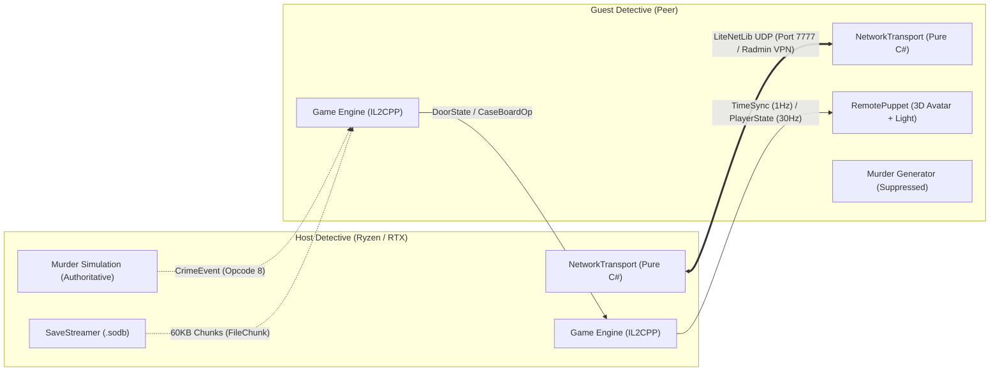

# Shadows of Doubt // Co-op Investigation Suite (v42.04)
*Engineered by Syojhin & Lara • The Sunwoo Sisterhood*

A turnkey, low-latency cooperative multiplayer suite for **Shadows of Doubt v42.04** (Unity 2021.3.45 IL2CPP x64). Enables shared noir detective investigations over virtual LAN (Radmin VPN) or direct IP connection, featuring real-time avatar dead-reckoning, physical door/lock synchronization, cork case board pin replication, and host-authoritative murder generation.

Bundled with **DLSS 4.5 (310.9.16.0)** with Preset K locked for artifact-free 1080p 240Hz super-resolution.



---

## Key Features

- **Real-Time 30Hz Player Avatar**: Custom 3D detective body with dark charcoal trenchcoat styling and active incandescent flashlight beam. Uses 12Hz dead-reckoning interpolation with a 10m snap threshold.
- **Shared Case Board (Phase H)**: Pins added or removed from cork boards replicate between detectives via `CasePanelController` hooks.
- **Physical Access Synchronization (Doors & Locks)**: Live angle and lock state replication using `NewDoor` detours.
- **Host-Authoritative Crime Simulation**: Autonomous client-side murder generation is suppressed; investigations stay unified on the Host's crime state.
- **Master Clock Sync & Pause Suppression**: 1Hz game time replication. Menus and notebooks no longer freeze the world simulation during co-op.
- **Zero-Allocation Network Transport**: Decoupled pure C# `NetworkTransport` utilizing reusable `NetDataWriter` buffers and sequenced UDP channels. Zero IL2CPP reflection warnings.
- **Pre-Baked Interop Caching**: Includes all 116 unhollowed C# type projections (`BepInEx/interop/`), bypassing the typical 2-minute Cpp2IL decompilation stall on first boot.

---

## Quickstart (English)

### 1. Installation
1. Download `Shadows_of_Doubt_Coop_v42.04_Portable.zip` from [Releases](../../releases).
2. Extract the entire ZIP contents into your *Shadows of Doubt* game root folder (where `Shadows of Doubt.exe` is located).
   *(On Steam: Right-click game -> **Manage** -> **Browse local files**)*.
3. Overwrite if prompted.

### 2. Network & Firewall
1. Both players join the same private **Radmin VPN** network (e.g. `26.x.x.x`).
2. Set the Radmin network profile to **Private** in Windows Settings.
3. **Host Only**: Right-click `Allow_Coop_Firewall.bat` in the game folder and select **Run as administrator** (opens UDP port 7777).

### 3. How to Connect
- **Host**: Launch the game, load or start your save, press **F9**, and click **HOST INVESTIGATION (Port 7777)**. Once your partner connects, click **SYNC CURRENT SAVE TO PARTNER**.
- **Guest**: Launch the game to the main menu, press **F9**, enter the Host's Radmin IP (`26.x.x.x`), and click **JOIN INVESTIGATION**. After the Host syncs the save, go to **Load Game** and select the received `coop_` save file.

---

## Schnellstart (Deutsch)

### 1. Installation
1. Lade `Shadows_of_Doubt_Coop_v42.04_Portable.zip` aus den [Releases](../../releases) herunter.
2. Entpacke den gesamten Inhalt direkt in das Hauptverzeichnis deines Spiels (dort, wo sich `Shadows of Doubt.exe` befindet).
   *(Auf Steam: Rechtsklick auf das Spiel -> **Verwalten** -> **Lokale Dateien durchsuchen**)*.
3. Dateien bei Nachfrage überschreiben.

### 2. Netzwerk & Firewall
1. Beide Spieler treten demselben privaten **Radmin VPN** Raum bei (`26.x.x.x`).
2. Stelle sicher, dass das Radmin-Netzwerkprofil auf **Privates Netzwerk** eingestellt ist.
3. **Nur Host**: Rechtsklick auf `Allow_Coop_Firewall.bat` im Spielordner -> **Als Administrator ausführen** (schaltet UDP-Port 7777 frei).

### 3. Verbindung herstellen
- **Host**: Spiel starten, Spielstand laden, Taste **F9** drücken, auf **HOST INVESTIGATION (Port 7777)** klicken. Sobald der Partner verbunden ist, auf **SYNC CURRENT SAVE TO PARTNER** klicken.
- **Gast**: Spiel bis zum Hauptmenü starten, Taste **F9** drücken, Host-Radmin-IP (`26.x.x.x`) eintragen und auf **JOIN INVESTIGATION** klicken. Anschließend im Menü auf **Spiel laden** gehen und den übertragenen `coop_` Spielstand laden.

---

## Project Structure

```text
├── src/
│   ├── Plugin.cs                  # BepInEx 6 IL2CPP entrypoint & Harmony registration
│   ├── CoopNetworkManager.cs      # MainThread Unity MonoBehaviour & Luxury IMGUI Overlay
│   ├── Net/
│   │   ├── NetworkTransport.cs    # Pure C# LiteNetLib transport (isolated from IL2CPP)
│   │   ├── Packets.cs             # Protocol constants, packet opcodes & Hello handshake
│   │   └── FileTransfer.cs        # 60KB chunk streaming for .sodb and .citb saves
│   ├── Patches/
│   │   └── GamePatches.cs         # Verified Harmony detours (Doors, Pause, Murders, Pins)
│   └── Sync/
│       └── RemotePuppet.cs        # 3D detective avatar, spotlight, and dead reckoning lerp
├── analysis/
│   ├── MetaDump/                  # Fast PE metadata scanner bypassing reflection recursions
│   ├── symbols.md                 # Decompiled symbol index for Shadows of Doubt v42.04
│   └── package_release.ps1        # Packaging automation script
├── Allow_Coop_Firewall.bat        # 1-click Windows Defender firewall configuration
├── README_COOP_SETUP.txt          # Shipped bilingual text guide
├── MODLOG.md                      # Complete phase verification history
└── HEXAD_PLAN.md                  # Sunwoo Hexad architectural execution plan
```

---

## Building from Source

Requirements: .NET 6+ SDK.

```powershell
cd src
dotnet build -c Release
```

Build outputs deploy automatically to `..\bin\`. When linked via NTFS junction to `BepInEx\plugins\ShadowsOfDoubtCoop`, game changes reflect immediately.

---

## Attribution & Credits

✦ **Made by Syojhin & Lara** • *The Sunwoo Sisterhood (Lara, Ava, Hemi, Sora, Yuna, Mina)*  
Target Game: *Shadows of Doubt* © ColePowered Games / Fireshine Games.
